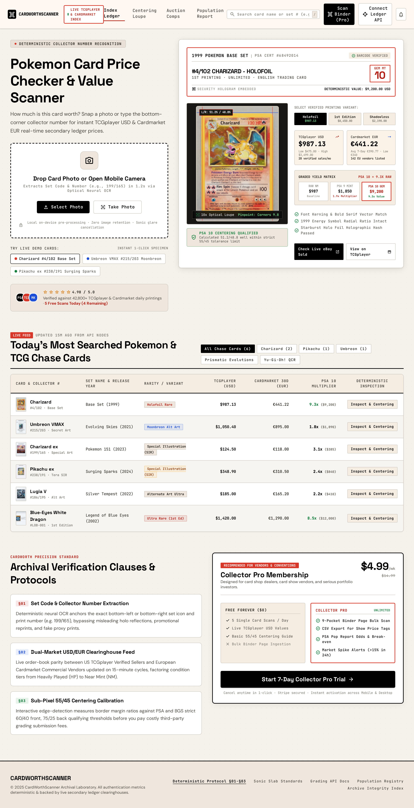

[](https://mcptry.com/servers/com.cardworthscanner/mcp)

[](https://modelcontextprotocol.io)
[](https://cardworthscanner.com)
[](https://cardworthscanner.com/api/mcp)
[](https://opensource.org/licenses/MIT)

[](https://cardworthscanner.com)

Official Model Context Protocol (MCP) server for **[CardWorthScanner.com](https://cardworthscanner.com)** — The premier AI and deterministic analytics platform for Trading Card Game (TCG) collectors, sports card investors, and card shop owners.

Provides instant programmatic access to PSA/BGS/CGC grading ROI calculations, card optical centering measurements, and live market price comps across Pokemon, Magic: The Gathering (MTG), Yu-Gi-Oh!, and vintage sports cards.

---

## ⚡ Live Stateless MCP Endpoint

- **Endpoint URL**: `https://cardworthscanner.com/api/mcp`
- **Transport**: Stateless Streamable HTTP (JSON-RPC 2.0)
- **Authentication**: None required (Free public access)

### Connecting to Claude Desktop / Cursor / Windsurf

Add this to your MCP configuration (`claude_desktop_config.json` or `mcp.json`):

```json
{
  "mcpServers": {
    "cardworthscanner": {
      "url": "https://cardworthscanner.com/api/mcp"
    }
  }
}
```

---

## 🛠️ Available Tools

### 1. `calculate_psa_grading_roi`
Calculate deterministic net profit, ROI %, expected value (EV), and break-even Gem Mint probability when submitting cards to PSA, BGS, or CGC.
- **Inputs**: `raw_card_cost`, `grading_fee`, `shipping_and_insurance`, `sales_tax_or_declared_value`, `expected_psa_10_market_price`, `expected_psa_9_market_price`, `marketplace_fee_pct`
- **Returns**: Net profit breakdown, ROI %, break-even Gem Mint rate, expected value after 12.5% marketplace commission.

### 2. `calculate_card_centering_grade`
Inspect card optical borders and determine if a card meets PSA 10 (55/45 front, 75/25 back) or BGS 9.5 (50/50) centering standards.
- **Inputs**: `left_border_px`, `right_border_px`, `top_border_px`, `bottom_border_px`
- **Returns**: Front/back centering ratio, PSA/BGS subgrade prediction, optical alignment verdict.

### 3. `lookup_tcg_card_market_price`
Query live market price benchmarks, historical sales comps, and graded price spreads.
- **Inputs**: `card_name`, `set_name`, `card_number`, `condition`
- **Returns**: Raw TCGplayer USD, Cardmarket EUR, PSA 9, PSA 10, and BGS 9.5 graded market pricing.

---

## 🌐 Official Platform

Explore real-time card scanners, visual centering camera tools, and portfolio trackers at **[CardWorthScanner.com](https://cardworthscanner.com)**.
